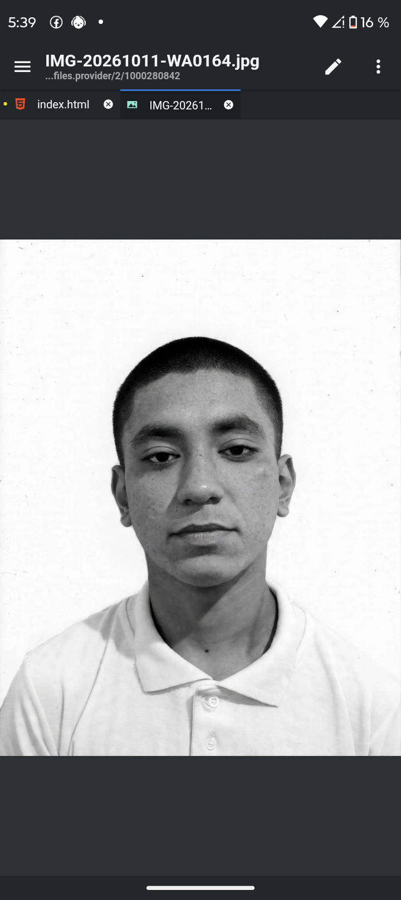

  
  <!-- Encabezado Institucional -->
  

    <h3 style="margin: 0; color: #2d472c; font-size: 1.2em; letter-spacing: 1px;">SECRETARÍA DE LA DEFENSA NACIONAL</h3>
    
ESTADOS UNIDOS MEXICANOS

    
CARTILLA DEL SERVICIO MILITAR NACIONAL

  

  
  <!-- Contenedor Principal (Foto + Datos) -->
  

    
    <!-- Sección de la Fotografía -->
    

      

        <!-- Si subes la foto como 'foto.jpg' en la misma carpeta, GitHub la cargará aquí -->
        Subir foto.jpg al repositorio';">
      

      
Fotografía Oficial

    

    
    <!-- Sección de Datos Personales -->
    

      
<strong>MATRÍCULA:</strong> D-6723459 &nbsp;&nbsp;&nbsp;&nbsp;&nbsp;&nbsp; <strong>CLASE:</strong> 2007

      
<strong>NOMBRE:</strong> OSEGUERA TELLO KEVIN DE JESÚS

      
<strong>FECHA DE NACIMIENTO:</strong> 12/08/2007

      
<strong>OCUPACIÓN:</strong> Ninguna

      
<strong>PADRE:</strong> Jesús Antonio Oseguera Ramírez

      
<strong>MADRE:</strong> Fabiola Tello Arano

    

  

  <!-- Contenedor Inferior: Estatus y Sello -->
  

    
    <!-- Estado de Liberación -->
    

      
<strong>SITUACIÓN:</strong>

      
LIBERADO (2026)

    

    
    <!-- Sello Oficial Digital -->
    

      S.M.N. SEDENA
      LIBERADO
      MÉXICO
    

  

 
<blockquote style="font-size: 0.85em; color: #666; max-width: 650px; margin: auto;">
  ⚠️ <strong>Disclaimer:</strong> Este documento es una simulación visual (mockup) con fines puramente académicos, de diseño o demostración en portafolio de desarrollo (GitHub). No cuenta con validez legal ni sustituye de ninguna forma los documentos oficiales emitidos por la Secretaría de la Defensa Nacional (SEDENA).
</blockquote>

